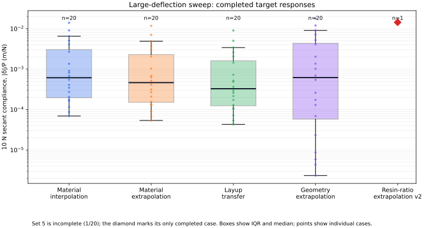

# Large-deflection transfer sweep: partial run report

**Run status: incomplete.** This is a report of the uploaded run output, not a completed calibration or validation trial.

## Executive result

The run contains **80/80 Dataset A responses** and **81/100 target responses** (161 completed simulations in total). The first four target sets are complete (20 cases each). The fifth set, `material_extrapolation_v2`, has only its first case. The next case failed in MAPDL due to excessive element distortion.

The failed case is **target case 81**: the response file ends at case 80, and the design table orders case 81 immediately after it. Case 81 is the 0.04 m wide, 8-ply member of `material_extrapolation_v2`. The trace reports errors for elements 7 and 121, followed by load step 1/substep 5 not completing and MAPDL starting bisection. No response for case 81 was saved.

**No model fitting, calibration, or held-out validation was completed.** There is no `model/` output in this run folder, so the current data cannot support an accuracy claim for the transfer models.

## FEA definition and response

The study uses a 0.25 m cantilever, a total 10 N transverse tip-edge load, fixed root, SHELL181 layered shells, a 40 x 6 structured mesh, and large-deflection nonlinear static analysis. Each reported compliance is the load-specific secant value

\[
C_{10}=\frac{|\delta_{tip}|}{10\,\mathrm{N}}.
\]

It is not a constant linear spring rate: large-deflection compliance can depend on load. The model uses illustrative elastic ply cards and does not include material damage, failure, impact dynamics, or a physical validation dataset. The resin-ratio target is a stiffness-only proxy with fixed density and ply thickness, so it must not be interpreted as resin uptake or a mass prediction.

## Completed response summary

| Dataset / target set | Completed | Compliance min / median / max (m/N) | Max \(|\delta|/L\) | Cases with \(|\delta|/L>0.1\) | Median recorded solve time |
|---|---:|---:|---:|---:|---:|
| Dataset A | 80/80 | 5.205e-5 / 6.139e-4 / 1.649e-2 | 0.660 | 22/80 | 11.66 s mean |
| Material interpolation | 20/20 | 6.940e-5 / 6.136e-4 / 1.401e-2 | 0.560 | 6/20 | 12.05 s |
| Material extrapolation | 20/20 | 5.381e-5 / 4.643e-4 / 1.178e-2 | 0.471 | 5/20 | 12.38 s |
| Layup transfer | 20/20 | 4.317e-5 / 3.277e-4 / 9.044e-3 | 0.362 | 4/20 | 12.29 s |
| Geometry extrapolation | 20/20 | 2.336e-6 / 6.199e-4 / 1.793e-2 | 0.717 | 6/20 | 20.79 s |
| Resin-ratio extrapolation v2 | 1/20 | 1.440e-2 / 1.440e-2 / 1.440e-2 | 0.576 | 1/1 | 18.44 s |

For the only completed v2 response (case 80; width 0.02 m, 8 plies, 1.2 mm total thickness), the tip displacement is approximately **0.144 m**, or **57.6% of the beam length**. This is a very compliant configuration and a strong-rotation case. A large displacement ratio alone does not prove the model is wrong, but it makes mesh and nonlinear-solution verification essential.

The geometry-extrapolation set contains two extreme recorded runtime outliers: case 60 (0.015 m wide, 8 plies) at **10,222 s (2.84 h)**, and case 61 (0.04 m wide, 8 plies) at **22,875 s (6.35 h)**. The other completed geometry cases have a median recorded runtime of 20.79 s. These values come from the supplied `fea_runtime_s` field; the ZIP does not include solver logs needed to distinguish MAPDL solve time from other runtime effects.

## Failure interpretation

The failure is now in the nonlinear solve itself, unlike the earlier postprocessing `SET` error. MAPDL reports **“Element 7 has excessive distortion”** and **“Element 121 has excessive distortion”**, then reports substep 5 not completed and begins bisection. This means the solver could not accept the deformed element state at that increment. The console excerpt does not include the full `.out` trace, so it does not establish whether the dominant cause is high local curvature, mesh resolution, load-step path, element formulation, or a modeling/constraint issue.

The compliant 8-ply cases are the clearest risk region: the completed v2 case 80 reaches \(|\delta|/L=0.576\); completed low-width, 8-ply cases elsewhere reach 0.66–0.72. Two of the slowest recorded cases are also 8-ply geometries. This pattern is consistent with difficult high-deformation solutions, but needs case-level log and mesh checks before treating that as a confirmed root cause.

The failure response must remain missing. Do not replace it with a linear estimate, treat the last converged substep as the full-load response, or include it as a valid training/validation label.

## Recommended next steps

1. **Keep the completed CSVs as the partial-run record.** The raw files below are the run outputs as supplied; the report does not edit or impute their values.
2. **Inspect the complete MAPDL `.out` file for case 81.** Check load-step settings, accepted/rejected substeps, final time/load fraction, displacement field and residuals. Save the log alongside the run.
3. **Run a focused mesh study for case 81** at the current mesh and a span-refined mesh (for example, doubling `nx` while holding all other inputs fixed). Compare tip displacement, element distortion, reactions, and convergence. If it still fails, inspect local shell axes and constraints, then test a smoother load ramp / more allowed substeps.
4. **Keep Dataset A and target load conditions consistent.** If the load or solver/mesh definition changes, rerun the affected datasets under a new output directory. Nonlinear compliance is load dependent.
5. **Do not start model fitting until Set 5 is resolved or the experimental scope is explicitly revised.** If the 8-ply cases are intentionally outside the solvable/valid domain, document that exclusion and regenerate a balanced design rather than silently dropping failures.
6. **Add explicit failure records to the runner before future full sweeps.** Each failed case should retain its case ID, input parameters, MAPDL error, and log path while remaining excluded from training and validation.

## Uploaded run files

The CSVs are included unchanged so the counts, case ordering, and numerical summaries can be checked:

- `dataset_A.csv` and `dataset_A_design.csv`
- `targets.csv` and `target_design.csv`

The target CSV contains 81 successful target responses, IDs 0–80. The target design CSV contains all 100 planned cases; IDs 81–99 have no result in this run.
